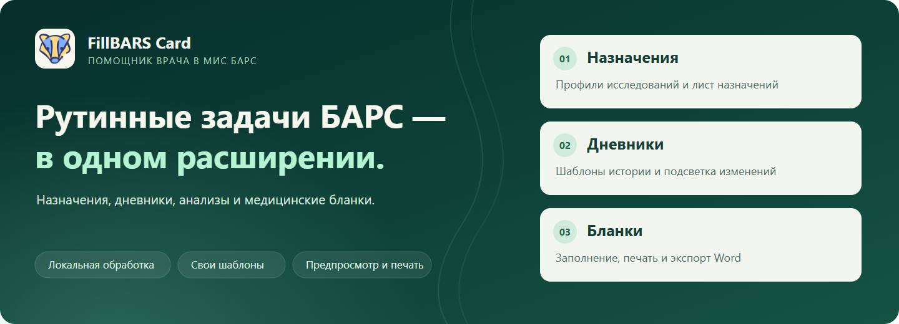
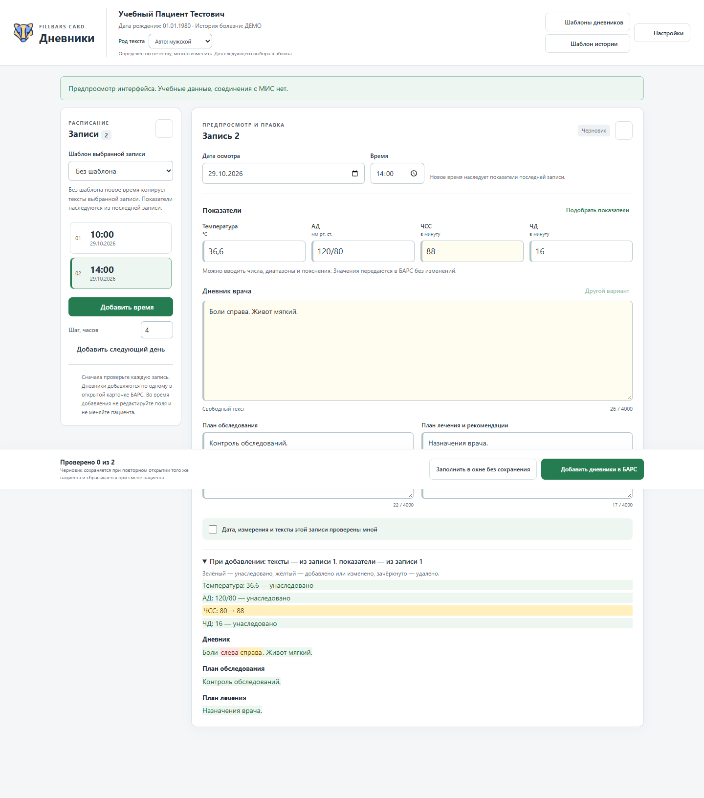
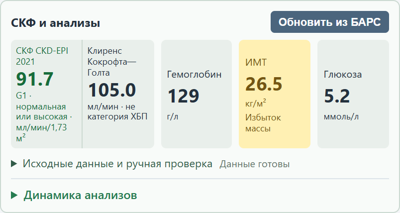
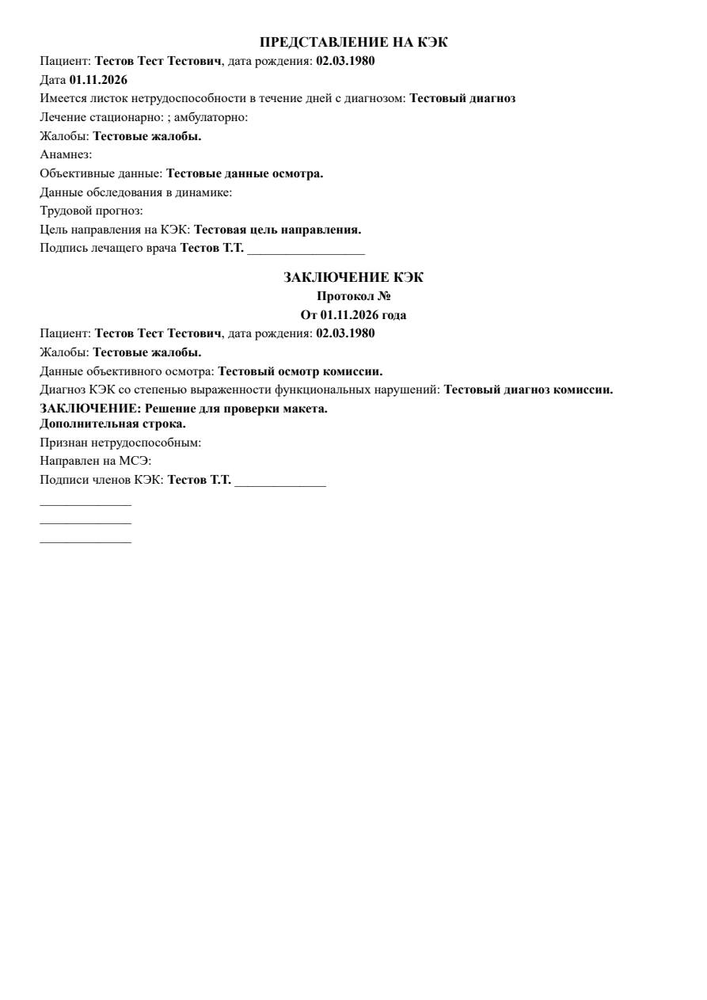

<div align="center">

[](https://chromewebstore.google.com/detail/lanifinlkkgcndcajmhfgjpgfklaacja)

# FillBARS Card

**Назначения, дневники и медицинские бланки из открытой карточки пациента.**

[](manifest.json)
[](manifest.json)
[](LICENSE)

### [Установить из Chrome Web Store →](https://chromewebstore.google.com/detail/lanifinlkkgcndcajmhfgjpgfklaacja)

[Возможности](#что-умеет-fillbars) · [Интерфейс](#посмотрите-как-это-выглядит) · [Быстрый старт](#быстрый-старт) · [Обратная связь](#обратная-связь)

</div>

FillBARS помогает сократить повторный ввод в повседневной работе с МИС БАРС: выбрать профиль исследований, подготовить серию дневников, посмотреть динамику анализов и открыть нужный бланк с данными пациента. Работает как расширение для Chrome / Chromium и Яндекс Браузера.

## Что умеет FillBARS

| | Возможности |
| --- | --- |
| 🧪 **Назначения по профилям** | Наборы лабораторных исследований, настройка CITO, подготовка листа назначений. Профили можно редактировать, экспортировать и переносить. |
| 📝 **Дневники врача** | Расписание на несколько дат, три текстовых поля, показатели температуры, АД, ЧСС и ЧД. Сохранение по одному через видимые формы БАРС. |
| 📚 **Ваши шаблоны истории** | Сохранение собственных текстов и показателей. В истории по почечной колике сторона меняется сразу во всех дневниках и планах. |
| 🔎 **Проверка изменений** | Подсветка новых и унаследованных фраз и показателей. Дополнительную сверку текста после сохранения можно включить в настройках. |
| 📈 **Анализы в динамике** | Графики и таблицы гемоглобина, креатинина и глюкозы. Расчёт СКФ, клиренса и ИМТ с подписью категории и цветовой подсветкой. |
| 🖨️ **Медицинские документы** | Заполнение полей, предпросмотр, печать и экспорт Word; для протокола трансфузии доступен также Excel. |

### Бланки под рукой

В меню **«Бланки»** собраны направления, заключения, согласия и протоколы:

- **Направления:** 057/у-04, СКТ, гистология 014/у с протоколом 014-1/у, телемедицинская консультация.
- **Комиссии:** заключение ВК, ВК для паллиативной помощи, представление и заключение КЭК на одном книжном листе А4.
- **Операции и вмешательства:** протокол операции, катетеризация центральной вены, согласия на операцию, анестезию и эндоскопические исследования.
- **Другие документы:** лист назначений, заявка на компоненты крови, протокол гемотрансфузии, онкологическое извещение, формы по производственным травмам и другие бланки.

Для операций доступны заготовки лапароскопической холецистэктомии, геморроидэктомии и грыжесечения. Тексты можно дополнить по фактически выполненному вмешательству.

## Посмотрите, как это выглядит

**Дневники: текст, показатели и подсветка правок в одном окне.**

[](docs/assets/readme/diaries.png)

<table>
<tr>
<td width="50%" valign="top">
<strong>Анализы и расчёты</strong><br><br>
<a href="docs/assets/readme/labs.png"></a>
<br>Основные показатели рядом. Исходные данные можно проверить и исправить.
</td>
<td width="50%" valign="top">
<strong>КЭК на одном листе</strong><br><br>
<a href="docs/assets/readme/cec.png"></a>
<br>Представление сверху, заключение снизу. Доступны печать и Word.
</td>
</tr>
</table>

*На изображениях — демонстрационные данные. Нажмите на изображение, чтобы рассмотреть его крупнее.*

## Быстрый старт

1. [Установите FillBARS из Chrome Web Store](https://chromewebstore.google.com/detail/lanifinlkkgcndcajmhfgjpgfklaacja) и закрепите значок на панели браузера.
2. Откройте карточку пациента в БАРС и нажмите значок FillBARS.
3. Выберите профиль назначений, откройте **«Дневники»** или нужный документ в меню **«Бланки»**.
4. Проверьте данные, внесите правки и выполните сохранение или печать.

При назначении исследований финальное сохранение в БАРС выполняет врач. В дневниках кнопка **«Добавить дневники в БАРС»** сохраняет предварительно проверенные записи последовательно. Во время отправки оставляйте карточку открытой и не меняйте пациента.

Расширение помогает подготовить записи и документы. Медицинские сведения, назначения и решения комиссии перед сохранением и подписанием проверяет врач.

[Руководство по дневникам →](docs/diaries.md)

## Данные остаются в вашем рабочем процессе

- Документы формируются в браузере. У расширения нет отдельного сервера для передачи данных пациента.
- Сохранение дневников выполняется через штатные формы вашей МИС БАРС и текущий вход в систему.
- Профили, настройки и библиотеки шаблонов хранятся локально в браузере.
- Черновики дневников хранятся на время сеанса браузера. Перед обновлением расширения завершите очередь и сохраните нужные тексты.
- Разрешения расширения: `activeTab`, `scripting`, `storage`. Внешние библиотеки через CDN не подключаются.

<details>
<summary><strong>Установка из исходников и проверки для разработчика</strong></summary>

Для использования расширения Node.js и сборка не требуются. Версия исходников — **5.2.43**; версия в магазине может отличаться, пока обновление проходит модерацию.

Скачать исходники можно [ZIP-архивом](https://github.com/MorozovRoman-hub/FillBARS/archive/refs/heads/master.zip) или через Git:

```sh
git clone https://github.com/MorozovRoman-hub/FillBARS.git
```

На странице расширений браузера включите режим разработчика, выберите **«Загрузить распакованное расширение»** и укажите папку с `manifest.json`. Для Chrome страница — `chrome://extensions`, для Яндекс Браузера — `browser://extensions`.

Минимальная версия Chrome / Chromium задана в manifest: **109**. После обновления файлов перезагрузите расширение и вкладку БАРС.

Для разработки нужен Node.js **24.15+**:

```sh
npm ci --ignore-scripts
npm test
npm run check
npm run test:upstream
```

Проверки работают с искусственными формами и подменёнными API, без записи в рабочую медицинскую карту. GitHub Actions запускает их в Linux и Windows.

Пакет для магазина собирается отдельно:

```sh
python scripts/build_webstore.py FillBARS-WebStore.zip
```

Скрипт собирает файлы среды выполнения и проверяет ресурсы внутри ZIP. Исходные медицинские документы, результаты тестов и материалы README в пакет не входят.

</details>

## Обратная связь

Нашли ошибку или хотите предложить бланк? [Создайте обращение в GitHub Issues](https://github.com/MorozovRoman-hub/FillBARS/issues/new).

Укажите версию расширения и браузера, последовательность действий и ожидаемый результат. Перед отправкой журнала или скриншота уберите персональные данные пациента.

Если FillBARS полезен в работе, поддержите проект звездой ⭐ и поделитесь ссылкой с коллегами.

---

**FillBARS Card** · [Chrome Web Store](https://chromewebstore.google.com/detail/lanifinlkkgcndcajmhfgjpgfklaacja) · [Исходный код](https://github.com/MorozovRoman-hub/FillBARS) · [MIT License](LICENSE)
